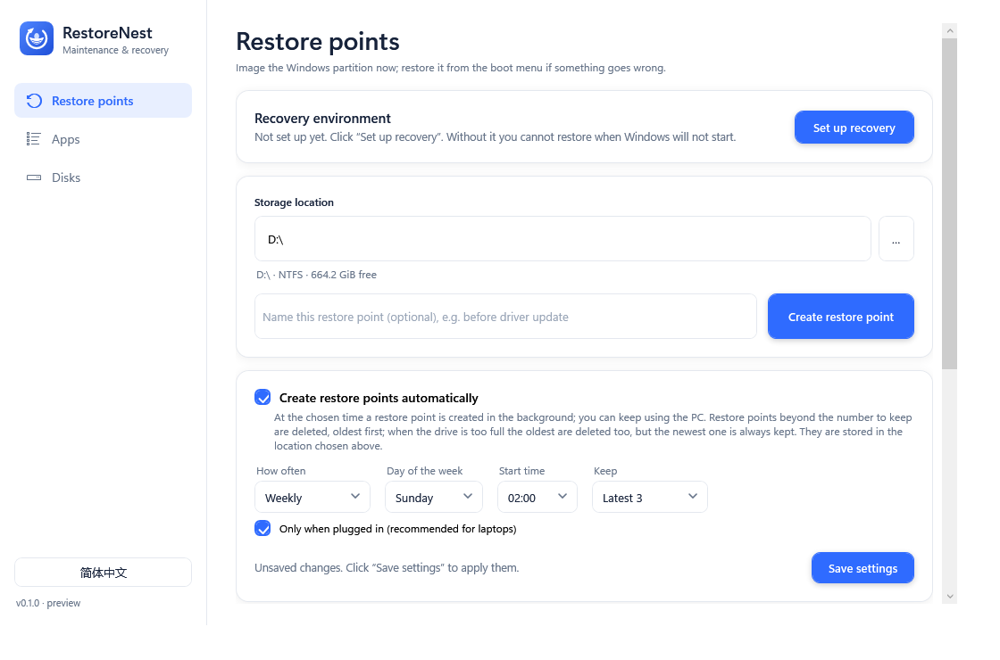
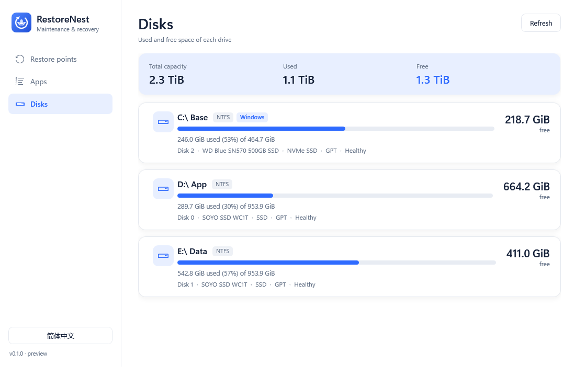
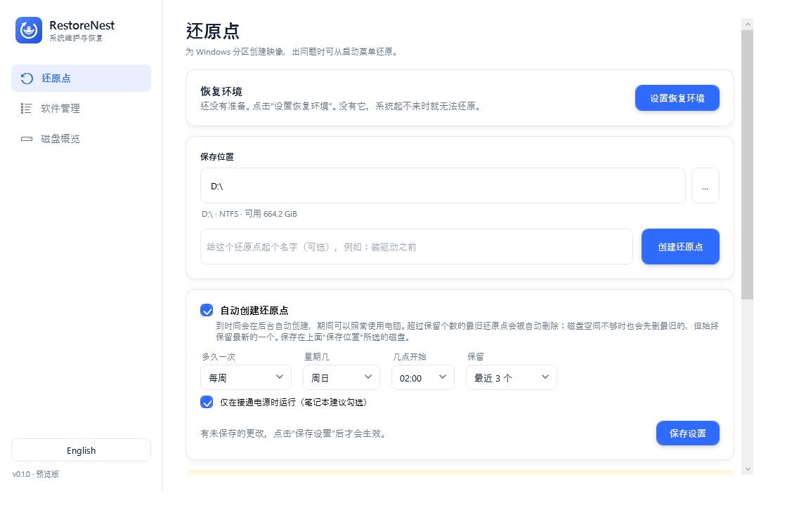
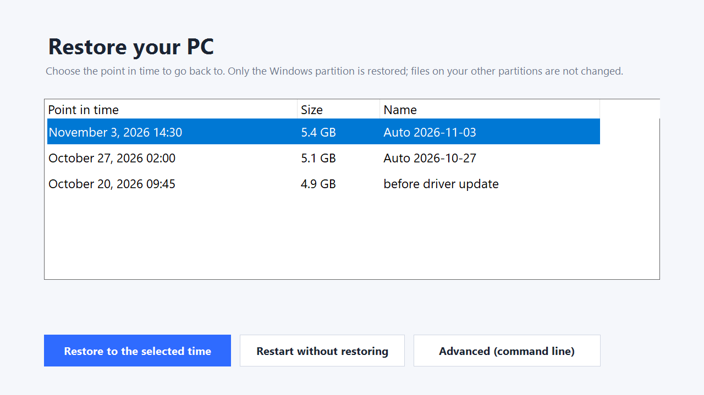
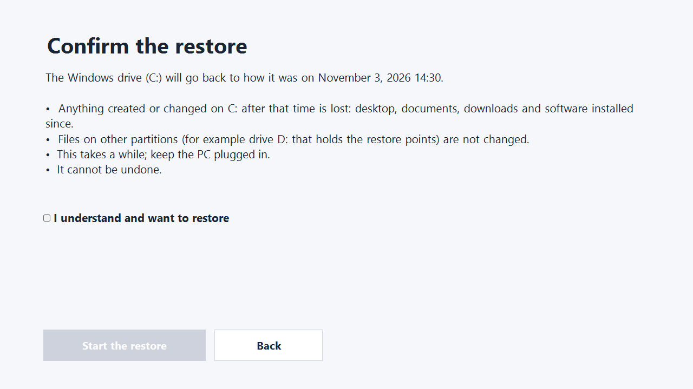
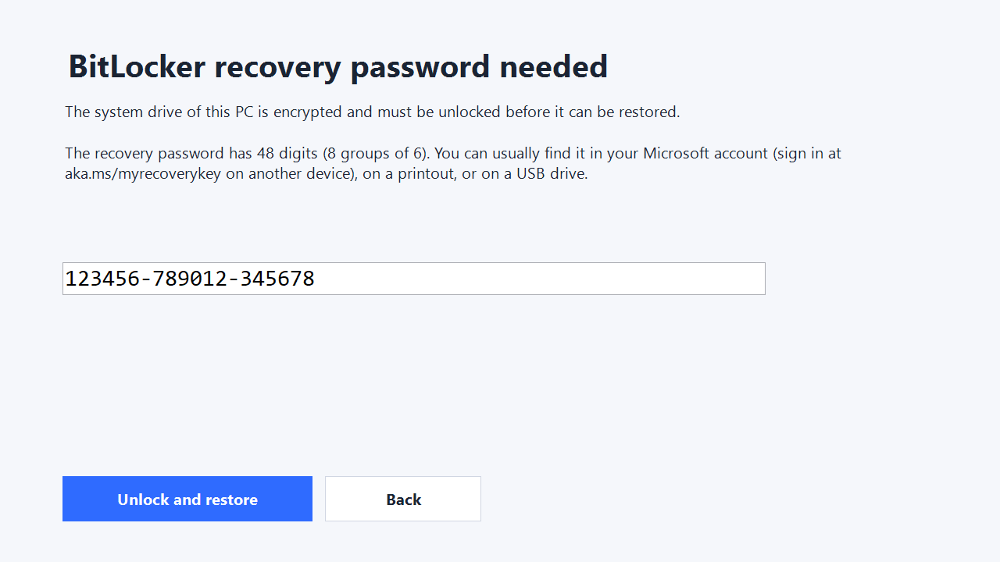

<p align="center">
  
</p>

<h1 align="center">RestoreNest</h1>

<p align="center">
  <b>Take a snapshot of Windows on a schedule. Go back to it with one click, even when Windows will not start.</b><br>
  Also lists and uninstalls installed software and shows disk usage.
</p>

<p align="center">
  
  
  
  
</p>

<p align="center">
  <a href="#why-restorenest">Why</a> ·
  <a href="#screenshots">Screenshots</a> ·
  <a href="#how-to-use-it-for-a-non-technical-user">How to use</a> ·
  <a href="#what-it-does">Features</a> ·
  <a href="#status-what-unverified-means">Status</a> ·
  <a href="#build-and-run">Build</a> ·
  <a href="#安全说明">中文说明</a>
</p>

> **Version 0.1.0: first runnable preview.** Parts are verified in virtual machines, parts are not, and nothing has run on physical hardware. Read [Status](#status-what-unverified-means) before trusting it with data.

## Why RestoreNest

- **Set it and forget it.** Pick how often (daily to monthly), at what time and how many to keep. Old points are removed automatically, also when the drive is full, but the newest one is always kept.
- **Works when Windows does not.** A "RestoreNest Recovery" entry is added to the boot menu. Its recovery screen is a plain graphical page: choose a point in time, tick the box, restore.
- **Your other drives stay untouched.** Only the Windows partition is restored. Restore points live on another drive or partition (the same physical disk is fine), never on the Windows drive.
- **Careful by design.** Every image is checked with SHA-256 and `wimlib verify`; the restore refuses the partition that holds the backup and is a dry run unless you confirm.
- **No manual tooling.** One click downloads wimlib and the Windows ADK from their official sites (signature and hash checked) and builds the recovery environment.
- **English and Chinese**, in the app and in the recovery screen.

## Screenshots

<table>
  <tr>
    <td width="50%"><br><sub><b>Restore points:</b> storage location, recovery setup, automatic schedule.</sub></td>
    <td width="50%"><br><sub><b>Disks:</b> totals, usage per drive, physical disk model, SSD/HDD type and health, restore points stored on each drive.</sub></td>
  </tr>
  <tr>
    <td><br><sub><b>中文界面：</b>还原点与自动保护。</sub></td>
    <td><br><sub><b>Recovery screen</b> (boot menu): pick the point in time.</sub></td>
  </tr>
  <tr>
    <td><br><sub><b>Confirm</b> what will be lost, then start.</sub></td>
    <td><br><sub><b>BitLocker:</b> asks for the 48-digit recovery password if the drive is locked.</sub></td>
  </tr>
</table>

<sub>The screenshots are rendered from the real app and recovery screen; the restore points in the recovery screens are demo data.</sub>

## What it does

| Area | Feature | Status |
|---|---|---|
| Apps | List registry and Store apps with size, publisher, version; search; multi-select | Built, unit-tested, app launch smoke-tested |
| Apps | Uninstall selected (MSI, registered uninstallers, Store apps); tries a Windows restore point first; lists leftover-folder candidates for you to confirm | **VM-verified** with real installers (7-Zip MSI, Notepad++ NSIS, a Store app, restore point first); the leftover-scan fix found there has unit tests only |
| Disks | Per-drive total / used / free overview | Built, tested |
| Restore points | Create a WIM image of the Windows partition (VSS snapshot online, or offline from WinPE) to **any non-Windows NTFS drive or folder (D:, E:, same physical disk allowed)**; several points coexist; SHA-256 + `wimlib verify` | **VM-verified offline** (4.5 GiB image, hashes OK). Script logic unit-tested. **Online VSS capture also VM-verified** (captured in the live guest, restored, logged in; the 7,609 s VM time is emulation, not real hardware) |
| Boot menu | `Install-BootEntry.ps1` adds a "RestoreNest Recovery" WinPE ramdisk entry (default OS and menu timeout preserved, BCD backed up first, removable) | **VM-verified**: install, boot into the recovery WinPE, remove. Also verified under Secure Boot, including selecting the entry with the keyboard. Not tested: TPM-bound BitLocker (the install prompt warns about the recovery key) |
| Restore | `Restore.ps1` (runs in WinPE): verifies the image, resolves the target by GPT GUID, refuses the partition holding the backup, dry-run by default, formats only the Windows partition | **VM-verified once per scenario** (Windows 10, UEFI, same-disk D:): data partition hashes and all partition GUIDs/sizes unchanged, backup still valid, a deliberately unbootable system booted to the lock screen afterwards |
| WinPE | `Build-WinPE.ps1` builds the recovery image (`boot.wim` + `boot.sdi`) with the Windows ADK + WinPE add-on; needs an elevated PowerShell and your own `wimlib-imagex.exe` | **VM-verified**: built with the real ADK 10.1.26100.9457 (about 49 min under emulation), then used for a full interactive restore from the boot menu. It needed four fixes on its first real run (see docs) |

Details, durations (QEMU emulation, not hardware speed), the bugs these runs found, and what is still untested: [docs/vm-validation.md](docs/vm-validation.md).

The old `wbadmin` route (backup page, recovery-task export, manifest verifier) was removed in 0.1.x; it stays in git history.

## How to use it (for a non-technical user)

1. **Set up the recovery environment, once.** Open the app, choose where restore points are stored (another drive such as D:, or an external disk; not the Windows drive), then click **Set up recovery**. If this PC does not have them yet, the app downloads wimlib and the Microsoft Windows ADK from their official sites (needs internet, roughly 1 to 3 GB, 20 to 60 minutes), builds the recovery environment and adds a "RestoreNest Recovery" entry to the boot menu. Windows stays the default.
2. **Turn on automatic restore points** (or click **Create restore point** whenever you like). You choose how often (daily, every 3 days, weekly, every 2 weeks, monthly), at what time and how many to keep. The oldest ones are deleted automatically, also when the drive is full, but the newest one is always kept.
3. **If Windows still works and you want to go back:** click **Restart and restore**. The PC restarts into the recovery screen once.
4. **If Windows does not start:** on the blue "Recovery" screen press **F9** and choose "RestoreNest Recovery". (Windows does not show the boot menu by itself when its own boot files are broken.)
5. In the recovery screen pick the point in time, read what will be lost, tick the box and start. When it says "Restore finished", click Restart.

If the Windows drive is protected by **BitLocker**, save the 48-digit recovery password now (the app shows a card with **Show recovery password** and **Save to a file**): the recovery screen asks for it. Restore points are plain image files, so the drive that holds them is not protected by BitLocker unless you turn it on for that drive too.

## Status: what "unverified" means

The restore path is the dangerous part. It has now been run end to end in a disposable VM (see below and [docs/vm-validation.md](docs/vm-validation.md)), but only on one Windows 10 image in a VM (also under Secure Boot and with a password-protected BitLocker volume), plus one Windows 11 image (restored from the Windows 10 WinPE), and never on physical hardware. Treat it as **experimental**: never run `Restore.ps1 -Execute` on a machine you cannot rebuild, and do not rely on it as your only backup. Engine notes: [docs/restore-point-engine.md](docs/restore-point-engine.md).

## Build and run

Requires the .NET 8 SDK and Windows. The app asks for administrator rights.

```bash
dotnet build src/SystemCare
dotnet run --project tests/SystemCare.Tests
powershell -ExecutionPolicy Bypass -File tests/RestorePoint.Tests.ps1
powershell -ExecutionPolicy Bypass -File tests/RestorePlan.Tests.ps1
```

Restore points need `wimlib-imagex.exe` and `libwim-15.dll` (wimlib 1.14.x, **GPLv3+ for the command-line tool**). They are not in this repository, and nothing of wimlib or the Windows ADK is redistributed with the app: **Set up recovery** downloads wimlib 1.14.5 from <https://wimlib.net> (the file is checked against a pinned SHA-256) into `tools\bin\`, and the ADK from Microsoft (the installers must carry a valid Microsoft signature before they are run). You can also place the two wimlib files in `tools\bin\` yourself. Review the licenses before redistributing a build that bundles them.

Lab helpers for a Hyper-V test VM are in `tools/lab`.

## 安全说明

0.1.x 是可运行的预览版。软件列表、卸载、磁盘概览可以使用（卸载已用真实安装包在虚拟机中验证；定时还原点和图形化恢复界面也已在虚拟机中跑通）。还原流程已在一个 Windows 10 虚拟机中端到端跑通：同一块盘上的 D 盘数据和分区布局保持不变，被破坏的系统还原后能启动到锁屏；启动菜单项可安装、可进入恢复环境、可移除。**Secure Boot 和密码保护的 BitLocker 卷也已在虚拟机中验证（BitLocker 系统分区还原需要恢复密码，还原后分区不再加密）；另有一个 Windows 11 镜像在虚拟机中验证通过（未开 Secure Boot/BitLocker）；但仍未验证 TPM 绑定的 BitLocker、未在真机验证，请勿用于重要数据。**还原脚本默认只做预检（不写入），仅格式化原 Windows 分区，不会触碰保存还原点的分区。使用 BitLocker 时，修改启动配置可能触发恢复密钥提示，请先备份密钥。wimlib 采用 GPLv3+，需自行下载放入 `tools\bin`。
